  

 

## ⚔️ Arsenal

<table>
  <tr>
    <td align="center" width="170"></td>
    <td></td>
  </tr>
  <tr>
    <td align="center"></td>
    <td></td>
  </tr>
  <tr>
    <td align="center"></td>
    <td></td>
  </tr>
  <tr>
    <td align="center"></td>
    <td></td>
  </tr>
  <tr>
    <td align="center"></td>
    <td></td>
  </tr>
</table>

## 📊 Battle Stats

## 🐉 Dragon vs. Contributions

<picture>
  <source media="(prefers-color-scheme: dark)" srcset="https://raw.githubusercontent.com/ThaoVuDEV/ThaoVuDEV/output/dragon-dark.svg" />
  <source media="(prefers-color-scheme: light)" srcset="https://raw.githubusercontent.com/ThaoVuDEV/ThaoVuDEV/output/dragon.svg" />
  
</picture>

## 📡 Comms

